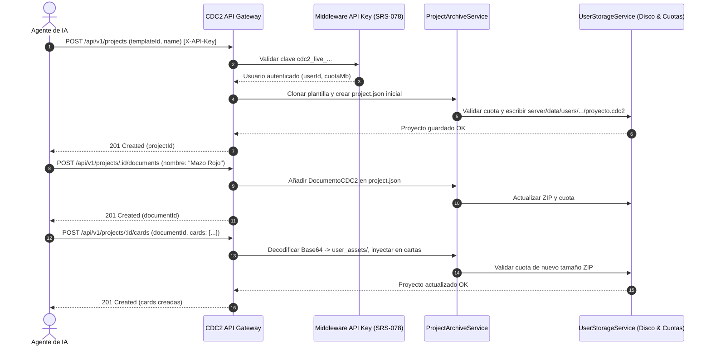

# SRS-079: Motor REST de Gestión de Proyectos en la Nube (.cdc2), Multidocumento y Cartas para Agentes IA

---

## 1. Introducción y Objetivos

### Propósito
Proveer un motor REST programático avanzado en Card Deck Crafter v2 (CDC2) que permita a agentes de Inteligencia Artificial (y sistemas automatizados externos autorizados mediante API Key de usuario - [SRS-078](file:///c:/Users/victo/proyectos/cdc2/developer/specs/srs_078_sistema_autenticacion_api_keys_usuarios_registrados.md)) operar de forma nativa sobre **proyectos completos en formato `.cdc2`** almacenados en la nube del usuario.

Este sistema supera las limitaciones del renderizado estático de imágenes individuales, habilitando un **flujo de trabajo iterativo e híbrido (Humano + IA)**:
1. La IA crea un proyecto basado en una plantilla pública o del usuario.
2. La IA estructura el proyecto en **múltiples documentos independientes** (por ejemplo, 5 documentos para 5 mazos de colores distintos al estilo *Magic: The Gathering*).
3. La IA añade cartas con sus textos, valores e ilustraciones (enviadas en Base64 o URLs) que el servidor incrusta automáticamente en el archivo `.cdc2` empaquetado.
4. Si la IA o el usuario detectan una errata o desean un balance numérico, la IA puede **corregir cartas específicas** de forma granular mediante la API.
5. El proyecto resultante queda disponible de inmediato en la cuenta del usuario para ser abierto en el editor visual de CDC2, permitiendo inspección humana, ajustes manuales y exportación final a PDF de alta resolución con marcas de corte y sangrado.

### Objetivos de Diseño
- **Persistencia en Formato Nativo `.cdc2`**: El backend manipula archivos ZIP que contienen el manifiesto `project.json` y la carpeta `user_assets/`, garantizando total compatibilidad con el editor web.
- **Soporte Multidocumento Integral**: Los proyectos pueden albergar múltiples documentos (`DocumentoCDC2`), cada uno con su propio conjunto de cartas y configuraciones de impresión.
- **Incrustación Automática de Recursos Multimedia**: Las imágenes suministradas en Base64 Data URL (`data:image/png;base64,...`) o URLs remotas se almacenan de forma segura dentro del ZIP como activos del proyecto (`user_asset://...`).
- **Control Estricto de Cuota de Almacenamiento**: Cada operación que incremente el tamaño del archivo `.cdc2` en disco verifica la cuota disponible del usuario antes de guardar, devolviendo `413 Payload Too Large / Quota Exceeded` si se rebasa el límite.
- **Previsualización a Demanda**: Capacidad de obtener el renderizado PNG de cualquier carta del proyecto para que el agente de IA evalúe visualmente su propia creación.
- **Portal de Documentación Actualizado**: Guía exhaustiva en `/developers` con especificación técnica de contratos y ejemplos de código completos en cURL, Python y Node.js.

---

## 2. Requisitos Funcionales y Casos de Uso

### RF-1: Creación de Proyecto en la Nube desde Plantilla (`POST /api/v1/projects`)
- **Descripción**: Endpoint autenticado que clona las plantillas de diseño de una plantilla pública aprobada (o plantilla privada del usuario) y genera un nuevo proyecto `.cdc2` en la nube del usuario.
- **Criterios de Aceptación**:
  - Parámetros JSON:
    - `templateId` (string, obligatorio): ID de la plantilla base pública o privada.
    - `name` (string, obligatorio): Nombre del proyecto (ej. *"Expansión Fantasía - 5 Mazos"*).
    - `description` (string, opcional): Descripción informativa.
  - Proceso en backend:
    1. Carga el archivo `.cdc2` de la plantilla origen.
    2. Extrae las plantillas de cartas (`templates`), fuentes y símbolos asociados.
    3. Inicializa un proyecto limpio con un documento por defecto y array de cartas vacío (`cards: []`).
    4. Empaqueta el archivo `.cdc2` inicial en el directorio personal del usuario (`server/data/users/<userId>/projects/<projectId>.cdc2`).
    5. Registra la entrada en la tabla SQLite `user_projects`.
  - Respuesta: `201 Created` con los metadatos del proyecto creado: `{ id, name, description, cardCount: 0, documentCount: 1, fileSizeBytes, createdAt }`.

### RF-2: Gestión de Multidocumento en el Proyecto (`POST` / `GET /api/v1/projects/:id/documents`)
- **Descripción**: Endpoints para inspeccionar y crear documentos adicionales dentro del proyecto para separar mazos, expansiones o tipos de componentes.
- **Criterios de Aceptación**:
  - `GET /api/v1/projects/:id/documents`: Devuelve la lista de documentos existentes en el proyecto `{ documents: [{ id, nombre, cardCount }] }`.
  - `POST /api/v1/projects/:id/documents`: Crea un nuevo documento dentro del proyecto.
    - Parámetros JSON:
      - `nombre` (string, obligatorio): Nombre del documento (ej. *"Mazo Rojo - Fuego"*, *"Mazo Azul - Control"*).
      - `canvasConfig` (objeto, opcional): Configuración de página (por defecto `A4` vertical con márgenes estándar).
      - `cardConfig` (objeto, opcional): Dimensiones de carta (heredadas del documento principal si no se especifican).
    - El backend actualiza `project.json` añadiendo la nueva entrada en `documentos` con `cards: []`.

### RF-3: Inserción de Cartas en Lote o Individuales (`POST /api/v1/projects/:id/cards`)
- **Descripción**: Permite añadir una o más cartas a un documento del proyecto, suministrando los valores de los campos expuestos y assets gráficos.
- **Criterios de Aceptación**:
  - Parámetros JSON:
    - `documentId` (string, opcional): ID del documento destino. Si se omite, se asigna al primer documento del proyecto.
    - `cards`: Array de objetos de carta, donde cada carta contiene:
      - `cardTemplateId` (string, obligatorio): ID del diseño de plantilla a utilizar (de los disponibles en el proyecto).
      - `name` (string, obligatorio): Nombre identificativo de la carta.
      - `count` (number, opcional, defecto `1`): Cantidad de copias en el mazo.
      - `fields` (objeto, opcional): Diccionario clave-valor con los textos/números a inyectar en `valoresCampos` de la carta.
      - `images` (objeto, opcional): Diccionario `{ [claveOCapaId]: string }` donde el valor es un Data URL Base64 o una URL HTTP/HTTPS.
  - **Tratamiento de Imágenes y Assets**:
    - Si se reciben imágenes en Base64 o URLs, el servidor genera un archivo físico dentro del directorio `user_assets/` del ZIP con nombre único (`img_<uuid>.<ext>`).
    - En la configuración de la carta, la capa correspondiente se enlaza con el protocolo interno `user_asset://<filename>`.
  - **Empaquetado y Persistencia**:
    - Se recalcula el nuevo archivo `.cdc2` y se verifica la cuota disponible antes de sobrescribir el archivo en disco.
    - Se actualiza el conteo global de cartas en `user_projects`.
  - Respuesta: `201 Created` con la lista de cartas creadas (incluyendo sus IDs autogenerados) y el nuevo estado de almacenamiento del usuario.

### RF-4: Modificación y Corrección de Cartas Existentes (`PUT /api/v1/projects/:id/cards/:cardId`)
- **Descripción**: Permite a un agente de IA corregir erratas, actualizar estadísticas o cambiar ilustraciones de una carta específica sin necesidad de recrear el proyecto.
- **Criterios de Aceptación**:
  - Parámetros JSON (campos parciales a actualizar):
    - `name` (string, opcional)
    - `count` (number, opcional)
    - `fields` (objeto, opcional): Actualiza o fusiona los valores en `valoresCampos`.
    - `images` (objeto, opcional): Sustituye los assets de imagen correspondientes en `user_assets/`.
  - El backend localiza la carta en el documento correspondiente, aplica las modificaciones, reempaqueta el ZIP, verifica la cuota y guarda el archivo.
  - Respuesta: `200 OK` con la carta actualizada.

### RF-5: Eliminación de Cartas (`DELETE /api/v1/projects/:id/cards/:cardId`)
- **Descripción**: Elimina una carta del proyecto y limpia opcionalmente sus assets huérfanos si ya no son referenciados por ninguna otra carta.
- **Criterios de Aceptación**:
  - Respuesta: `200 OK` confirmando la eliminación y devolviendo el nuevo conteo de cartas del proyecto.

### RF-6: Previsualización de Carta de Proyecto en PNG (`GET /api/v1/projects/:id/cards/:cardId/preview`)
- **Descripción**: Renderiza en tiempo real la carta especificada perteneciente al proyecto del usuario a una imagen `image/png` a 300 DPI utilizando el motor headless.
- **Criterios de Aceptación**:
  - El servidor lee la definición de la carta, sus assets embebidos en el ZIP y la plantilla de diseño correspondiente, renderizándola con Puppeteer y devolviendo el binario con cabecera `Content-Type: image/png`.

### RF-7: Validación Estricta de Cuota de Disco en Tiempo Real
- **Descripción**: Aplicación de las reglas de cuota definidas en [SRS-065](file:///c:/Users/victo/proyectos/cdc2/developer/specs/completed/srs_065_cuota_espacio_usuarios_admin.md) y [SRS-066](file:///c:/Users/victo/proyectos/cdc2/developer/specs/completed/srs_066_almacenamiento_proyectos_nube_cuota.md) en todas las operaciones de escritura.
- **Criterios de Aceptación**:
  - Si el tamaño del nuevo archivo `.cdc2` sobrepasa la cuota máxima permitida del usuario (`storage_quota_mb`), la operación se aborta de inmediato sin alterar el archivo original en disco.
  - Código HTTP: `413 Payload Too Large`.
  - Cuerpo de error: `{ error: "Cuota de almacenamiento excedida", code: "QUOTA_EXCEEDED", details: { usedMb, quotaMb, neededMb } }`.

### RF-8: Actualización de la Documentación para Desarrolladores (`/developers`)
- **Descripción**: Actualizar el componente [client/src/docs/DeveloperDocs.tsx](file:///c:/Users/victo/proyectos/cdc2/client/src/docs/DeveloperDocs.tsx) para incluir la documentación completa de la API con autenticación por API Key.
- **Criterios de Aceptación**:
  - Nueva sección destacada: **"Gestión de Proyectos en la Nube y Mazos con IA"**.
  - Explicación de la autenticación mediante cabecera `X-API-Key: cdc2_live_...`.
  - Explicación del modelo multidocumento con caso de uso de ejemplo (Creación de 5 mazos monocolor).
  - Snippets de código interactivos listos para ejecutar en **cURL**, **Python** y **Node.js** para:
    1. Crear un proyecto desde una plantilla pública.
    2. Crear documentos adicionales.
    3. Añadir cartas con ilustraciones Base64.
    4. Corregir una carta existente.
    5. Descargar la previsualización de una carta.

---

## 3. Arquitectura y Diseño de Datos

### 3.1. Flujo de Datos y Manipulación de Archivos `.cdc2`



### 3.2. Interfaces TypeScript (`shared/apiTypes.ts`)

```typescript
export interface CreateProjectFromTemplateRequest {
  templateId: string;
  name: string;
  description?: string;
}

export interface CreateDocumentRequest {
  nombre: string;
  canvasConfig?: Partial<CanvasConfig>;
  cardConfig?: Partial<CardConfig>;
}

export interface AddCardsToProjectRequest {
  documentId?: string;
  cards: Array<{
    cardTemplateId: string;
    name: string;
    count?: number;
    fields?: Record<string, any>;
    images?: Record<string, string>; // Base64 Data URL o URL HTTP
  }>;
}

export interface UpdateProjectCardRequest {
  name?: string;
  count?: number;
  fields?: Record<string, any>;
  images?: Record<string, string>;
}
```

---

## 4. Interfaces de Componentes / API

### Resumen de Endpoints del Módulo de Proyectos

| Método | Ruta | Cabecera Requerida | Descripción |
| :--- | :--- | :--- | :--- |
| `POST` | `/api/v1/projects` | `X-API-Key` | Crea un proyecto `.cdc2` en la nube a partir de una plantilla |
| `GET` | `/api/v1/projects` | `X-API-Key` | Lista los proyectos en la nube del usuario |
| `GET` | `/api/v1/projects/:id` | `X-API-Key` | Devuelve el detalle del proyecto, plantillas y documentos |
| `POST` | `/api/v1/projects/:id/documents` | `X-API-Key` | Añade un nuevo documento al proyecto (multidocumento) |
| `GET` | `/api/v1/projects/:id/documents` | `X-API-Key` | Lista los documentos del proyecto |
| `POST` | `/api/v1/projects/:id/cards` | `X-API-Key` | Añade una o varias cartas a un documento del proyecto |
| `PUT` | `/api/v1/projects/:id/cards/:cardId` | `X-API-Key` | Modifica o corrige una carta existente |
| `DELETE` | `/api/v1/projects/:id/cards/:cardId` | `X-API-Key` | Elimina una carta del proyecto |
| `GET` | `/api/v1/projects/:id/cards/:cardId/preview` | `X-API-Key` | Renderiza el PNG de la carta en alta resolución |
| `GET` | `/api/v1/projects/:id/download` | `X-API-Key` | Descarga directa del archivo binario `.cdc2` |

---

## 5. Estrategia de Verificación (Pruebas)

### 5.1. Pruebas Unitarias Automatizadas
- **`server/src/engine/projectArchiveService.test.ts`**:
  - Creación de proyecto `.cdc2` a partir de un archivo de plantilla base.
  - Creación de múltiples documentos dentro de `project.json` y verificación de integridad.
  - Inserción de cartas con decodificación de Data URLs Base64 a `user_assets/` del ZIP.
  - Modificación de campos en cartas existentes (`PUT`) asegurando que los valores previos no alterados se preserven.
  - Eliminación de cartas y actualización del conteo.
  - Prueba de límite de cuota: simulación de subida de imágenes pesadas que exceden la cuota del usuario y confirmación del rechazo con error `413`.
- **`client/src/SRS079ApiDeveloperDocs.test.tsx`**:
  - Verificación del renderizado de la nueva sección de gestión de proyectos en `/developers`.
  - Verificación de snippets de código para operaciones CRUD de cartas y multidocumento.

### 5.2. Checklist de Pruebas Manuales
1. Crear una API Key para el usuario de pruebas siguiendo SRS-078.
2. Ejecutar una petición `POST /api/v1/projects` pasando el ID de una plantilla pública aprobada y el nombre *"Proyecto de Prueba IA"*.
3. Verificar en la base de datos y en el explorador de archivos que se ha creado el archivo `.cdc2` bajo el usuario correspondiente.
4. Crear un segundo documento *"Mazo 2"* mediante `POST /api/v1/projects/:id/documents`.
5. Enviar 2 cartas con campos de texto e imagen Base64 mediante `POST /api/v1/projects/:id/cards`.
6. Solicitar la previsualización en PNG de una de las cartas generadas mediante `GET /api/v1/projects/:id/cards/:cardId/preview` y abrir la imagen devuelta.
7. Modificar un campo de texto de una carta mediante `PUT /api/v1/projects/:id/cards/:cardId`.
8. Iniciar sesión en la aplicación web de CDC2, abrir **"Mis Proyectos en la Nube"**, cargar el proyecto recién creado y comprobar que ambos documentos y sus cartas se visualizan y editan perfectamente en la interfaz de usuario.
