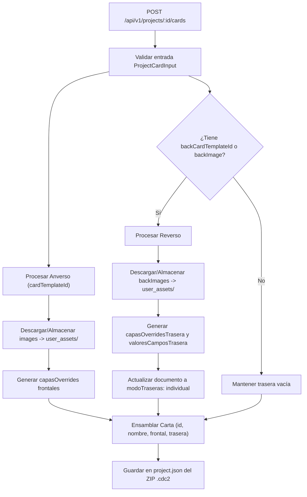

# SRS-081: Soporte de Reversos con Plantillas, Configuración de Traseras y Esquema Estructurado en la API REST

- **ID del Requisito**: SRS-081
- **Título**: Soporte de Reversos con Plantillas, Configuración de Traseras y Esquema Estructurado en la API REST
- **Estado**: 📝 En Revisión / Propuesta
- **Fecha**: 2026-10-18
- **Autor**: Antigravity & Usuario (CDC2 Team)

---

## 1. Introducción y Objetivos

### 1.1. Propósito
Extender el motor de API REST de Card Deck Crafter v2 para permitir la creación y manipulación de cartas con reversos completos listos para impresión profesional. Esto incluye la asignación de plantillas independientes para el reverso (`plantillaTraseraId`), inyección de campos y gráficos traseros específicos (`backFields`, `backImages`), y la configuración explícita del modo de reversos a nivel de documento (`modoTraseras: "individual" | "comun" | "ninguno"`).

Adicionalmente, se evoluciona el manifiesto de diseño entregado a los agentes de IA (`GET /api/v1/projects/:id` y `GET /api/v1/cards/templates/:id`) para estructurar la información en dos bloques bien diferenciados: **Campos Expuestos** (`exposedFields`) y **Estructura Completa de Capas** (`fullStructure`), permitiendo que el agente conozca con precisión qué elementos debe alterar por diseño sin perder la capacidad de consultar o manipular la jerarquía completa si es necesario.

### 1.2. Objetivos de Diseño
1. **Reversos Ricos Basados en Plantillas**: Una carta generada vía API debe poder combinar cualquier plantilla frontal con cualquier plantilla trasera disponible en el proyecto, soportando overrides independientes en cada cara.
2. **Control del Modo de Reversos en Documentos**: La creación de proyectos y documentos mediante la API debe permitir definir el modo de traseras (`individual`, `comun`, `ninguno`) y assets comunes (`imagenTraseraComun`).
3. **Claridad Semántica para Agentes de IA**: Separar de forma explícita los campos marcados como editables por el diseñador (`exposedFields`) de la radiografía técnica completa (`fullStructure`), reduciendo alucinaciones y modificaciones no deseadas en capas estructurales.
4. **Retrocompatibilidad**: Mantener la tolerancia de la API para que las peticiones existentes que solo envían `cardTemplateId`, `fields` e `images` sigan funcionando sin cambios.

---

## 2. Requisitos Funcionales y Casos de Uso

### RF-1: Configuración de Reversos a Nivel de Proyecto y Documento
- **RF-1.1**: En el endpoint de creación de proyectos (`POST /api/v1/projects`) y creación de documentos (`POST /api/v1/projects/:id/documents`), se admiten los siguientes parámetros opcionales en el cuerpo de la petición:
  - `modoTraseras` (`"individual" | "comun" | "ninguno"`, opcional, por defecto `"individual"` si se especifican plantillas o imágenes de reverso, o `"ninguno"` si no se especifican).
  - `imagenTraseraComun` (`string`, opcional): Imagen Data URL en Base64 o URL remota HTTP/HTTPS a asociar como reverso compartido para todo el documento si `modoTraseras` es `"comun"`.
- **RF-1.2**: El documento generado en `project.json` debe inicializar `modoTraseras` e `imagenTraseraComun` conforme a los parámetros recibidos. Al abrir el proyecto en el cliente web, la casilla *"Generar reversos"* reflejará inmediatamente el estado configurado (`modoTraseras !== "ninguno"`).

### RF-2: Inyección de Reversos con Plantillas e Imágenes en Cartas (`POST /api/v1/projects/:id/cards`)
- **RF-2.1**: El objeto de carta de entrada (`ProjectCardInput`) se extiende para aceptar parámetros de reverso:
  - `backCardTemplateId` (`string`, opcional): ID de la plantilla de diseño a utilizar para la cara trasera de la carta.
  - `backFields` (`Record<string, any>`, opcional): Diccionario clave-valor con los textos o números a inyectar en `valoresCamposTrasera` y `capasOverridesTrasera`.
  - `backImages` (`Record<string, string>`, opcional): Diccionario clave-valor donde cada valor es una Data URL Base64 o URL remota, procesada y almacenada en `user_assets/` del archivo `.cdc2` y vinculada a la capa trasera correspondiente (`user_asset://...`).
  - `backImage` (`string`, opcional): Imagen trasera directa para la carta (`imagenTrasera`), compatible con Data URL Base64 o URL externa.
- **RF-2.2**: Si la carta incluye `backCardTemplateId`, el backend verifica que la plantilla exista en `templates` del proyecto y genera:
  - `plantillaTraseraId`: ID de la plantilla asignada.
  - `valoresCamposTrasera`: Mapa con los valores recibidos en `backFields` y `backImages`.
  - `capasOverridesTrasera`: Diccionario de overrides aplicado a las capas de la plantilla trasera según coincidencia de `id` o `nombre`.
- **RF-2.3**: Si el documento tenía previamente `modoTraseras: "ninguno"`, al insertar cartas que definen `backCardTemplateId` o `backImage`, el backend actualiza automáticamente el documento a `modoTraseras: "individual"` para asegurar que los reversos queden activados y visibles en el editor y en la exportación.

### RF-3: Actualización de Reversos en Cartas Existentes (`PUT /api/v1/projects/:id/cards/:cardId`)
- **RF-3.1**: El endpoint de actualización permite modificar parcialmente o cambiar la plantilla trasera y campos de reverso de una carta:
  - `backCardTemplateId`: Cambia la plantilla trasera asignada.
  - `backFields`: Actualiza o fusiona los campos traseros.
  - `backImages`: Reemplaza o añade ilustraciones traseras.
  - `backImage`: Actualiza la imagen trasera individual.

### RF-4: Previsualización de Reverso en PNG (`GET /api/v1/projects/:id/cards/:cardId/preview`)
- **RF-4.1**: Se añade el parámetro de consulta `side` (`front` | `back`, por defecto `front`):
  - Si `side=back`, el motor headless renderiza la cara trasera de la carta (utilizando `plantillaTraseraId`, `capasOverridesTrasera` o `imagenTrasera`).
  - Si la carta no cuenta con reverso configurado pero el documento tiene `imagenTraseraComun`, renderiza el reverso común.
  - Si no existe ningún reverso disponible, devuelve error descriptivo `404 Not Found`.

### RF-5: Esquema Dual en la API: Campos Expuestos vs Estructura Completa
- **RF-5.1**: En las respuestas de inspección de plantilla (`GET /api/v1/projects/:id` y `GET /api/v1/cards/templates/:id`), cada objeto de diseño de plantilla (`TemplateDesignSchema`) se estructura en dos apartados:
  ```typescript
  export interface TemplateDesignSchema {
    id: string;
    nombre: string;
    dimensiones: { anchoMm: number; altoMm: number };
    totalCapas: number;
    miniatura?: string;

    // 1. Campos oficialmente expuestos para edición recomendada
    exposedFields: TemplateFieldSchema[];

    // 2. Estructura técnica completa de todas las capas
    fullStructure: TemplateLayerSummary[];
  }
  ```
- **RF-5.2**: `exposedFields` contiene únicamente los campos declarados en `exposedProperties` o `camposConfig` de la plantilla, con su etiqueta amigable (`label`), propiedad vinculada (`property`) y tipo de dato.
- **RF-5.3**: `fullStructure` expone la lista completa de capas con su jerarquía, `id`, `nombre`, `tipo`, dimensiones y valores base (`contenidoRaw`, `src`, etc.).
### RF-6: Actualización Integral del Portal de Documentación para Desarrolladores (`/developers`)
- **RF-6.1**: Actualizar el componente [`client/src/docs/DeveloperDocs.tsx`](file:///c:/Users/victo/proyectos/cdc2/client/src/docs/DeveloperDocs.tsx) para incluir:
  - Documentación detallada del parámetro `modoTraseras` en proyectos y documentos.
  - Ejemplos interactivos en **cURL**, **Python** y **Node.js** de cómo inyectar cartas con `cardTemplateId` (frontal) y `backCardTemplateId` (reverso con plantilla), junto con `backFields` y `backImages`.
  - Explicación de la previsualización del reverso mediante `GET /preview?side=back`.
  - Explicación de la estructura del esquema dual (`exposedFields` como campos prioritarios para agentes, y `fullStructure` como jerarquía técnica).

### RF-7: Archivo y Herramienta Descargable `SKILL.md` para Agentes de IA
- **RF-7.1**: Crear una especificación de agente estándar (Skill) en formato Markdown con frontmatter YAML compatible con Antigravity, Cursor, Claude Code y OpenAI Code Interpreter (`card-deck-crafter-agent-skill.md`).
- **RF-7.2**: El skill incluirá:
  - **Metadata**: `name: card-deck-crafter`, `description: Instrucciones y protocolo de API para diseñar, generar y validar cartas y mazos con Card Deck Crafter v2`.
  - **Instrucciones de Protocolo**: Guía paso a paso para que cualquier agente en un proyecto externo sepa:
    1. Cómo comprobar conectividad y autenticarse con `X-API-Key`.
    2. Cómo inspeccionar las plantillas públicas y privadas distinguiendo entre `exposedFields` y `fullStructure`.
    3. Cómo crear proyectos, documentos y configurar `modoTraseras: "individual"`.
    4. Cómo estructurar el payload con anverso (`fields`) y reverso (`backFields`, `backCardTemplateId`).
    5. Cómo validar el resultado descargando previsualizaciones PNG antes de entregar el archivo `.cdc2`.
    6. Manejo de cuotas (`413 Payload Too Large`) y códigos de estado.
- **RF-7.3**: En la interfaz web de `/developers`, habilitar un bloque destacado con:
  - Botón **"📥 Descargar SKILL.md"** (descarga directa de archivo `.md`).
  - Botón **"📋 Copiar Skill"** (copia directa al portapapeles con confirmación visual).
- **RF-7.4 (Endpoint Servidor)**: Habilitar un endpoint en el backend `GET /api/v1/docs/agent-skill` que sirva el contenido del skill en formato `text/markdown`, permitiendo a agentes remotos descargarlo programáticamente vía `curl http://localhost:3000/api/v1/docs/agent-skill > .agents/skills/card-deck-crafter/SKILL.md`.

---

## 3. Arquitectura y Diseño de Datos

### 3.1. Nuevas Interfaces y Tipos Compartidos (`shared/apiTypes.ts`)

```typescript
export interface TemplateLayerSummary {
  id: string;
  nombre: string;
  tipo: string;
  parentCapaId?: string | null;
  contenidoRaw?: string;
  src?: string;
  visibilidad?: string;
}

export interface TemplateDesignSchema {
  id: string;
  nombre: string;
  dimensiones: {
    anchoMm: number;
    altoMm: number;
  };
  totalCapas: number;
  miniatura?: string;
  exposedFields: TemplateFieldSchema[];
  fullStructure: TemplateLayerSummary[];
  campos?: TemplateFieldSchema[]; // Alias retrocompatible
}

export interface CreateDocumentRequest {
  nombre: string;
  canvasConfig?: Record<string, any>;
  cardConfig?: Record<string, any>;
  modoTraseras?: "individual" | "comun" | "ninguno";
  imagenTraseraComun?: string;
}

export interface ProjectCardInput {
  // Cara Frontal
  cardTemplateId: string;
  name: string;
  count?: number;
  fields?: Record<string, any>;
  images?: Record<string, string>;

  // Cara Trasera (Reverso)
  backCardTemplateId?: string;
  backFields?: Record<string, any>;
  backImages?: Record<string, string>;
  backImage?: string;
}
```

### 3.2. Mapeo en el Motor de Proyectos (`server/src/engine/projectArchiveService.ts`)



---

## 4. Documentación y Ejemplos de Uso (`/developers`)

Se actualizará [`client/src/docs/DeveloperDocs.tsx`](file:///c:/Users/victo/proyectos/cdc2/client/src/docs/DeveloperDocs.tsx) con ejemplos específicos de creación de barajas con anverso y reverso:

```json
{
  "documentId": "doc_heroes",
  "cards": [
    {
      "cardTemplateId": "template_hero_front",
      "backCardTemplateId": "template_hero_back",
      "name": "Mago del Tiempo",
      "count": 3,
      "fields": {
        "nombre": "Mago del Tiempo",
        "descripcion": "Manipula el flujo temporal."
      },
      "images": {
        "arte": "data:image/png;base64,..."
      },
      "backFields": {
        "lore": "Perteneciente a la orden de Cronos.",
        "nivel": "Nivel 4"
      }
    }
  ]
}
```

---

## 5. Estrategia de Verificación y Pruebas

### 5.1. Pruebas Unitarias Automatizadas (`server/src/engine/projectArchiveService.test.ts`)
1. **Creación de documento con reversos**:
   - Verificar que al crear un documento con `modoTraseras: "individual"` se persiste correctamente en `project.json`.
2. **Inserción de carta con plantilla trasera**:
   - Comprobar que una carta creada con `backCardTemplateId`, `backFields` y `backImages` genera `plantillaTraseraId`, `capasOverridesTrasera` y almacena los assets traseros en el ZIP.
3. **Activación automática de reversos en documento**:
   - Comprobar que si el documento tenía `modoTraseras: "ninguno"` y se inserta una carta con reverso, el documento se actualiza automáticamente a `modoTraseras: "individual"`.
4. **Esquema dual**:
   - Comprobar que `mapDesignToSchema` devuelve tanto `exposedFields` (filtrados por campos expuestos) como `fullStructure` (todas las capas).
5. **Previsualización de reverso**:
   - Comprobar que `GET .../preview?side=back` renderiza la cara trasera de la carta.
6. **Descarga y contenido del Skill para agentes (`GET /api/v1/docs/agent-skill`)**:
   - Comprobar que el endpoint responde `200 OK`, `Content-Type: text/markdown` y contiene el frontmatter YAML y las instrucciones completas de la API.
7. **Portal de Desarrolladores UI (`SRS081DeveloperDocsSkill.test.tsx`)**:
   - Comprobar que `/developers` renderiza los bloques de reversos y los botones de descarga y copia del `SKILL.md`.

### 5.2. Checklist de Pruebas Manuales
- [ ] Acceder a `/developers` y pulsar el botón *"📥 Descargar SKILL.md"*, comprobando que descarga el archivo Markdown listo para usar.
- [ ] Probar el botón *"📋 Copiar Skill"* y verificar que el contenido se copia al portapapeles.
- [ ] Ejecutar `curl http://localhost:3000/api/v1/docs/agent-skill` y comprobar la respuesta en Markdown.
- [ ] En un proyecto externo con un agente de IA, colocar el archivo `SKILL.md` y pedirle que genere cartas con frontal y reverso.
- [ ] Abrir el archivo `.cdc2` generado en el editor web de Card Deck Crafter v2.
- [ ] Comprobar que la casilla *"Generar reversos"* aparece marcada por defecto.
- [ ] Alternar entre la pestaña *"Delantera"* y *"Trasera"* en el inspector y comprobar que los valores inyectados por la API se muestran correctamente en ambas caras.
- [ ] Verificar la vista previa del reverso con la acción de descarga PNG.
