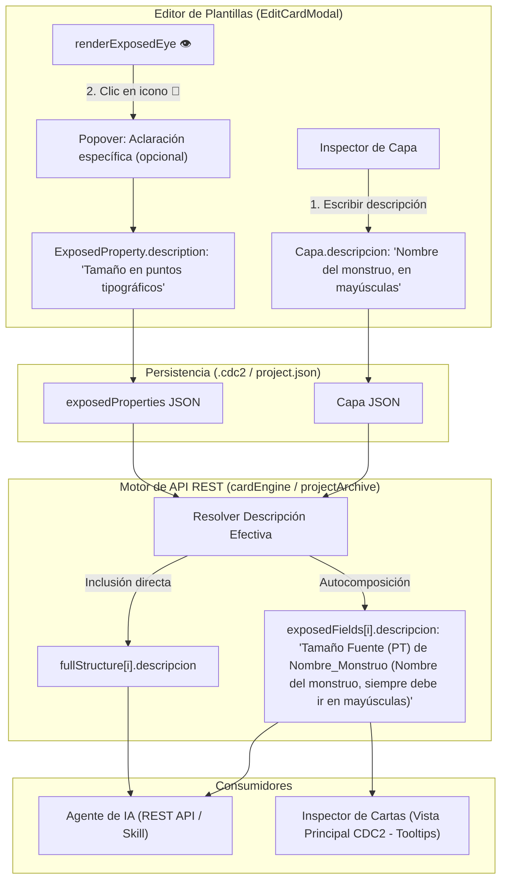

# SRS-082: Descripciones Semánticas y Directrices para IA en Elementos y Propiedades Expuestas de Plantillas

- **ID del Requisito**: SRS-082
- **Título**: Descripciones Semánticas y Directrices para IA en Elementos y Propiedades Expuestas de Plantillas
- **Estado**: 📝 En Revisión / Propuesta Detallada
- **Fecha**: 2026-10-19
- **Autor**: Antigravity & Usuario (CDC2 Team)

---

## 1. Introducción y Objetivos

### 1.1. Propósito
Actualmente, las plantillas de cartas en Card Deck Crafter v2 (`Plantilla`) definen una lista de propiedades expuestas (`ExposedProperty`) compuestas únicamente por un puntero a la capa (`layerId`), la propiedad física a alterar (`property`, ej. `texto`, `fontSize`, `src`) y una etiqueta visual (`label`, ej. `"Nombre"`, `"Coste"`, `"Fuerza"`). 

Cuando un usuario maquetador o un agente de Inteligencia Artificial interactúa con la plantilla a través de la API REST (`GET /api/v1/projects/:id` o `GET /api/v1/templates/:id/schema`), las etiquetas breves resultan insuficientes para comprender:
1. El significado y propósito narrativo/mecánico del elemento (ej. "¿es el nombre de la criatura o el subtipo?").
2. Reglas de formateo o directrices estilísticas (ej. *"Siempre debe ir en mayúsculas"*, *"Admite símbolos de maná entre llaves {R}, {G}"*).
3. Restricciones de diseño visual (ej. *"Máximo 3 líneas recomendadas para no desbordar el contenedor"*).

Esta especificación tiene por objeto incorporar un sistema de **Descripciones Semánticas y Directrices para IA y Maquetadores** en dos niveles jerárquicos:
- **A nivel de Elemento / Capa**: Un campo de texto multilínea (`descripcion`) en el inspector de la capa del editor de cartas (`EditCardModal`), donde el diseñador define el propósito del elemento una sola vez.
- **A nivel de Propiedad Expuesta**: Un icono de aclaración (`📝`) desplegable junto al botón de exponer (`👁️`) y en el configurador de campos expuestos, permitiendo afinar o sobreescribir opcionalmente las directrices para una propiedad particular.

Toda esta información se procesa y sintetiza automáticamente en los endpoints de esquema (`exposedFields` y `fullStructure`) y en la interfaz de usuario de la vista principal.

### 1.2. Objetivos de Diseño
1. **Definición Centralizada y Ahorro de Esfuerzo (DRY)**: El diseñador redacta las directrices del elemento una sola vez en el inspector de la capa, y todas sus propiedades expuestas heredan dicho contexto automáticamente sin trabajo redundante.
2. **Afinamiento Opcional por Propiedad**: Permitir que el diseñador detalle instrucciones específicas para una propiedad puntual (ej. un rango numérico o formato de color) mediante un botón discreto junto al ojo de exposición `👁️`.
3. **Formateo Sintético Contextualizado para Agentes de IA**: En la API REST, cada campo expuesto (`exposedFields`) incluye una descripción compuesta y clara con el formato:
   `"${label} de ${capa.nombre}${descripcionEfectiva ? ` (${descripcionEfectiva})` : ''}"`
   *(Ejemplo: `"Tamaño Fuente (PT) de Nombre_Monstruo (Nombre del monstruo, siempre debe ir en mayúsculas)"`)*.
4. **Inspección Técnica Enriquecida**: En `fullStructure`, cada capa del árbol incluye su descripción para que agentes o desarrolladores comprendan la arquitectura de la plantilla incluso en capas no expuestas.
5. **Guía Visual para el Maquetador Humano**: Mostrar estas descripciones como tooltips informativos o textos de ayuda en el inspector compacto de la vista principal.

---

## 2. Requisitos Funcionales y Casos de Uso



### RF-1: Extensión de los Modelos de Datos en Capas Compartidas
- **RF-1.1**: Ampliar la interfaz `CapaBase` en `shared/layoutEngine.ts` para admitir el campo opcional:
  ```typescript
  export interface CapaBase {
    id: string;
    nombre: string;
    tipo: TipoCapa;
    visible: boolean;
    descripcion?: string; // Directrices semánticas e indicaciones del elemento
    // ...resto de propiedades
  }
  ```
- **RF-1.2**: Ampliar la interfaz `ExposedProperty` en `shared/layoutEngine.ts`:
  ```typescript
  export interface ExposedProperty {
    layerId: string;
    property: string;
    label: string;
    description?: string; // Aclaración específica opcional para esta propiedad
  }
  ```
- **RF-1.3**: Actualizar `TemplateFieldSchema` y `TemplateLayerSummary` en `shared/apiTypes.ts`:
  ```typescript
  export interface TemplateFieldSchema {
    clave: string;
    nombre: string;
    tipo: 'string' | 'multiline' | 'image' | 'number' | 'select';
    descripcion?: string; // Formateada contextualizadamente para IA y maquetadores
    opciones?: string[];
  }

  export interface TemplateLayerSummary {
    id: string;
    nombre: string;
    tipo: string;
    descripcion?: string; // Descripción original de la capa
    // ...resto de campos
  }
  ```

### RF-2: Editor de Cartas - Descripción Semántica a Nivel de Elemento (`EditCardModal.tsx`)
- **RF-2.1**: En el panel inspector lateral de `EditCardModal`, inmediatamente debajo del campo editable de nombre de capa (`selectedCapa.nombre`), incorporar una sección para la descripción del elemento.
- **RF-2.2**: El campo consistirá en un `<textarea>` estilizado según el tema de CDC2:
  - Altura inicial compacta (2 o 3 líneas).
  - Placeholder: *"Directrices e indicaciones de este elemento para IA y maquetadores..."*.
  - Enlace bidireccional mediante `handleUpdateCapaProp(selectedCapa.id, "descripcion", e.target.value)` tanto para plantillas frontales como traseras (`tempPlantilla` y `tempPlantillaTrasera`).
- **RF-2.3**: Si el campo está vacío, la capa no guarda cadenas vacías superfluas (`undefined` o `""`).

### RF-3: Editor de Cartas - Icono y Desplegable de Descripción en Propiedades Expuestas (`renderExposedEye`)
- **RF-3.1**: Modificar el helper `renderExposedEye(property, propertyLabel, isCompact)` en `EditCardModal.tsx`:
  - Cuando la propiedad esté expuesta (`isExposed === true`), renderizar a su derecha inmediata un botón discreto de descripción (`📝` o icono SVG de nota).
  - **Estado visual del icono**:
    - Si la propiedad ya cuenta con una aclaración específica (`prop.description`), el icono se muestra resaltado con color de acento (`var(--accent-primary)`) y opacidad 1.0.
    - Si no tiene aclaración específica (hereda la del elemento), se muestra con opacidad sutil (ej. 0.45) indicando que es configurable.
- **RF-3.2**: Al hacer clic en el icono de descripción:
  - Desplegar un pequeño popover o panel flotante anclado (o modal compacto inline) con:
    - Título: *"Aclaración específica para: [propertyLabel]"*.
    - Texto informativo o placeholder que muestre como referencia la descripción actual del elemento padre.
    - Un `<textarea>` para redactar la directriz puntual de esa propiedad.
    - Botones de acción: *"Aceptar"* (guarda en `tempExposedProperties`) y *"Limpiar / Cancelar"*.
- **RF-3.3**: Al pulsar Aceptar, se actualiza el objeto `ExposedProperty` correspondiente en el estado local de la plantilla activa (`tempPlantilla` / `tempPlantillaTrasera`).

### RF-4: Modal de Configuración y Reordenación de Campos Expuestos
- **RF-4.1**: En el modal de gestión global de campos expuestos (`showExposedConfigModal`), dentro de la tarjeta de cada propiedad expuesta:
  - Debajo del campo `Etiqueta:`, mostrar un campo o botón colapsable *"Aclaración para IA / Descripción:"*.
  - Permitir consultar y editar directamente `prop.description`.

### RF-5: Formateo y Composición Semántica en la API REST
- **RF-5.1**: En `server/src/engine/projectArchiveService.ts` (`mapDesignToSchema`) y `server/src/engine/cardEngineService.ts` (`getPublicTemplateSchema`), actualizar la generación de `exposedFields`:
  - Para cada `ExposedProperty`:
    1. Localizar la capa vinculada (`capa = capas.find(c => c.id === prop.layerId)`).
    2. Determinar la directriz semántica efectiva:
       - Si `prop.description` tiene texto, se toma esta aclaración.
       - Si no, se toma `capa?.descripcion`.
    3. Componer la cadena de `descripcion`:
       - Si existe directriz efectiva: `"${prop.label} de ${capa?.nombre || 'Capa'} (${directrizEfectiva})"`
       - Si no existe directriz: `"${prop.label} de ${capa?.nombre || 'Capa'}"`
- **RF-5.2**: En la generación de `fullStructure` (`TemplateLayerSummary`):
  - Incluir el campo `descripcion: capa.descripcion || ""` para cada capa del diseño.

### RF-6: Tooltips de Ayuda en el Inspector de Cartas (Vista Principal)
- **RF-6.1**: En `client/src/App.tsx`, en el panel lateral derecho donde se editan los valores de las cartas seleccionadas:
  - Al lado de la etiqueta de cada propiedad expuesta, si dicha propiedad tiene directriz semántica (generada por `prop.description` o `capa.descripcion`), mostrar un icono informativo `ℹ️` o el atributo nativo `title` sobre la etiqueta.
  - Al posar el cursor, el usuario ve la directriz completa redactada por el diseñador de la plantilla.

### RF-7: Actualización del Portal `/developers` y `SKILL.md`
- **RF-7.1**: Actualizar la documentación en `DeveloperDocs.tsx` y el contenido del skill descargable (`agentSkillContent.ts`) explicando el uso de `descripcion` en `exposedFields` y en `fullStructure`.
- **RF-7.2**: Indicar a los agentes de IA que deben leer atentamente el campo `descripcion` de cada propiedad para respetar restricciones semánticas y estilísticas del creador del juego.

---

## 3. Ejemplos de Respuesta de la API REST

### 3.1. Inspección de Plantilla (`GET /api/v1/projects/:id` o `/api/v1/templates/:id/schema`)

```json
{
  "id": "tpl_criatura_epica",
  "nombre": "Plantilla Criatura Fantasía",
  "dimensiones": { "anchoMm": 63, "altoMm": 88 },
  "totalCapas": 12,
  "exposedFields": [
    {
      "clave": "Nombre_Criatura",
      "nombre": "Nombre de la Carta",
      "tipo": "string",
      "descripcion": "Nombre de la Carta de Nombre_Criatura (Nombre del monstruo, siempre debe ir en mayúsculas y no exceder 25 caracteres)"
    },
    {
      "clave": "Tam_Fuente_Nombre",
      "nombre": "Tamaño Fuente (PT)",
      "tipo": "number",
      "descripcion": "Tamaño Fuente (PT) de Nombre_Criatura (Ajustar entre 12 y 18 pt si el nombre es especialmente largo)"
    },
    {
      "clave": "Ilustracion_Criatura",
      "nombre": "Arte de la Criatura",
      "tipo": "image",
      "descripcion": "Arte de la Criatura de Ilustracion_Criatura (Ilustración vertical con proporción 4:3, fondo transparente recomendado)"
    }
  ],
  "fullStructure": [
    {
      "id": "layer_001",
      "nombre": "Nombre_Criatura",
      "tipo": "text",
      "descripcion": "Nombre del monstruo, siempre debe ir en mayúsculas y no exceder 25 caracteres",
      "dimensiones": { "anchoMm": 55, "altoMm": 8 }
    },
    {
      "id": "layer_002",
      "nombre": "Ilustracion_Criatura",
      "tipo": "image",
      "descripcion": "Ilustración vertical con proporción 4:3, fondo transparente recomendado",
      "dimensiones": { "anchoMm": 55, "altoMm": 45 }
    }
  ]
}
```

---

## 4. Plan de Pruebas y Criterios de Aceptación

### Backend & Modelos
1. **Composición de Descripción**: Verificar que una plantilla con capa que tiene `descripcion` genera en `exposedFields` la fórmula `"${label} de ${capa.nombre} (${descripcion})"`.
2. **Prioridad de Sobrescritura**: Verificar que si una `ExposedProperty` tiene su propio `description`, este prevalece sobre la descripción genérica de la capa en `exposedFields`.
3. **Persistencia en Proyecto CDC2**: Crear un proyecto con capas y propiedades expuestas con descripción, guardar en archivo `.cdc2`, volver a cargarlo y comprobar que los textos persisten íntegros.
4. **Presencia en `fullStructure`**: Verificar que `fullStructure` incluye `descripcion` en cada capa.

### Frontend
1. **Renderizado del Textarea de Capa**: Comprobar que al seleccionar una capa en `EditCardModal`, aparece el `<textarea>` de descripción y actualiza el estado de la capa.
2. **Botón de Aclaración 📝**: Comprobar que en propiedades expuestas aparece el icono `📝`, y que al pulsarlo abre el popover/modal para editar la directriz específica.
3. **Configurador de Campos Expuestos**: Comprobar que en `showExposedConfigModal` se puede visualizar y modificar la aclaración de cada propiedad expuesta.
4. **Tooltips en Vista Principal**: Comprobar que en el inspector derecho de la vista principal se visualizan las directrices al pasar el ratón.
