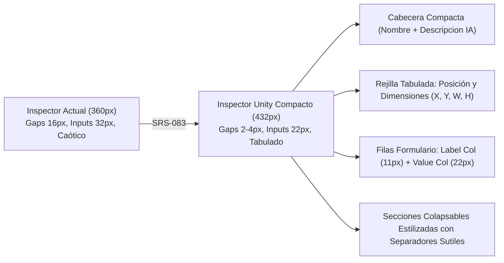

# SRS-083: Densidad Visual, Tabulación y Rediseño Compacto del Inspector en el Editor de Cartas

- **ID del Requisito**: SRS-083
- **Título**: Densidad Visual, Tabulación y Rediseño Compacto del Inspector en el Editor de Cartas
- **Estado**: ✅ Completado
- **Fecha**: 2026-10-19
- **Autor**: Antigravity & Usuario (CDC2 Team)

---

## 1. Introducción y Objetivos

### 1.1. Propósito
Optimizar la ergonomía, organización visual y densidad de información del panel lateral derecho (Inspector de Propiedades de Capa) dentro del modal de edición visual de cartas ([EditCardModal.tsx](file:///c:/Users/victo/proyectos/cdc2/client/src/EditCardModal.tsx)).

Siguiendo la misma filosofía de diseño profesional que se aplicó en el inspector de la vista principal ([SRS-080](file:///c:/Users/victo/proyectos/cdc2/developer/specs/completed/srs_080_densidad_visual_e_inspector_compacto_estilo_unity.md)), el inspector del editor de cartas actualmente adolece de:
1. Una columna lateral estrecha (`360px`) que comprime los controles y fuerza cortes en etiquetas compuestas.
2. Márgenes, gaps y paddings verticales sobredimensionados (`16px` entre secciones, `12px` en campos, paddings de `8px 12px` en inputs) que dispersan los controles y exigen un scroll excesivo.
3. Desalineación entre etiquetas y valores: campos apilados verticalmente de forma caótica sin un sistema consistente de tabulación en rejilla o columnas limpias.
4. Controles sobredimensionados (selectores de color de `38px × 38px`, botones altos, inputs de `32px` de altura).

Este rediseño transforma la columna derecha del editor de cartas en un panel técnico ordenado, denso y armónico inspirado en el Inspector de Unity, Blender y herramientas de maquetación profesional.

### 1.2. Objetivos de Diseño
1. **Ampliación del Ancho en un 20%**: Pasar el ancho de la columna del inspector de `360px` a **`432px`** para que las etiquetas, controles y botones de acción quepan con holgura y sin solaparse.
2. **Alta Densidad de Información**: Reducir drásticamente los espacios en blanco, paddings y márgenes improductivos para que el diseñador pueda visualizar la mayoría de propiedades de un elemento en un único golpe de vista.
3. **Tabulación y Alineación Ordenada**: Establecer un sistema de filas de formulario consistentes con dos columnas (etiqueta a la izquierda con ancho equilibrado, valor o control a la derecha) o rejillas compactas para coordenadas y dimensiones (X, Y, Ancho, Alto).
4. **Dimensionado Compacto de Controles**: Homogeneizar inputs, selects, botones de acción y selectores de color a una altura estándar de `22px` con tipografía de `11px`.
5. **Conservación Total de Funcionalidades**: Mantener intactas todas las capacidades interactivas (el ojo `👁️` de exposición, el icono `📝` de directrices para IA de SRS-082, edición en lienzo, selectores de tipografía y color, inserción de símbolos y galerías).

---

## 2. Requisitos Funcionales y Casos de Uso



### RF-1: Ampliación del Ancho de la Columna del Inspector (+20%)
- **RF-1.1**: En el layout de rejilla de tres columnas de `EditCardModal.css` (`.edit-modal-body`):
  - Actualizar `grid-template-columns`:
    - **Antes**: `300px 1fr 360px;`
    - **Después**: `300px 1fr 432px;` *(360px × 1.20 = 432px)*.
- **RF-1.2**: El contenedor del modal (`.edit-modal-container`) adaptará fluidamente el espacio central de previsualización sin alterar la proporción de la carta ni la columna de jerarquía.

### RF-2: Reducción de Márgenes y Padding del Contenedor del Inspector
- **RF-2.1**: En `.inspector-column .column-content`:
  - Reducir el padding general de `16px` a **`8px 12px`**.
- **RF-2.2**: En el panel contenedor `.inspector-panel`:
  - Reducir el `gap` vertical de `16px` a **`6px`**.
- **RF-2.3**: En la cabecera de la capa seleccionada (`.inspector-layer-header`):
  - Reducir el gap de `12px` a `6px`.
  - El icono de capa (`.inspector-layer-icon`) pasa de `20px` a `15px`.
  - El input del nombre de la capa (`.inspector-header-input`) mantiene tipografía destacada (`13px - 14px`, `font-weight: 600`), pero reduce sus paddings a `2px 4px`.
- **RF-2.4**: En el textarea de descripción de SRS-082 (`.inspector-description-textarea`):
  - Ajustar a un aspecto ultracompacto (altura inicial de 2 filas, fuente `11px`, padding `3px 6px`).

### RF-3: Eliminación de Gaps y Separación Continua entre Secciones
- **RF-3.1**: Eliminar todos los estilos inline que introducen márgenes arbitrarios (`marginTop: "16px"`, `paddingTop: "16px"`, `marginBottom: "12px"`, etc.).
- **RF-3.2**: Las secciones de propiedades (`.inspector-group-section`) pasan a tener una separación limpia con:
  - Borde superior sutil (`border-top: 1px solid var(--border-color)`).
  - Padding superior compacto de `6px` a `8px`.
  - Margen inferior nulo (`margin: 0`).
- **RF-3.3**: Los títulos de sección (`.inspector-group-title`) reducen su tamaño a **`11px`**, en mayúsculas / negrita (`font-weight: 700`), con color atenuado (`var(--text-secondary)`), acompañados a la derecha por su botón de exposición `renderExposedEye` alineado a la derecha.

### RF-4: Sistema de Tabla Densa Multi-Celda (`.inspector-table` y `.inspector-cell`)
- **RF-4.1 (Estructura Tipo Tabla Aprovechando Huecos Horizontales)**: Los campos de cada sección se agrupan dentro de contenedores `.inspector-table` con bordes y divisores de celda sutiles. Cada fila (`.inspector-field-row`) puede alojar 1, 2, 3 o 4 celdas horizontales (`.inspector-cell`), situando siempre la etiqueta inmediatamente a la izquierda de su control (`[Etiqueta] [Control]`) para eliminar espacios muertos y minimizar el scroll vertical:
  - **Posición y Dimensiones**:
    - Fila 1: `[Alineación Rápida] [⬅️][↔️][➡️][⬆️][↕️][⬇️][⏹️]` junto con el botón `[🖱️ Editar en Lienzo]` en la misma línea horizontal.
    - Fila 2: `[X 👁️][input] | [Y 👁️][input] | [W 👁️][input] | [H 👁️][input]` en una sola línea de 4 celdas con la etiqueta a la izquierda del input (`24px` de alto total).
    - Fila 3: `[Autoajuste] [☑ Ancho Auto] [☑ Alto Auto]` en una sola línea.
  - **Padding del Texto**:
    - Cuando está colapsado, el título desplegable `[Padding del Texto 👁️ ▶]` y el campo `[General (mm)] [input]` comparten **una única línea horizontal**. Al expandirse, muestra las 4 direcciones (`Sup.`, `Der.`, `Inf.`, `Izq.`) en una sola fila de 4 celdas.
  - **Visibilidad**:
    - Los selectores `[Carta] [select]` (anulación) y `[Plantilla] [select]` (base) se sitúan uno al lado del otro en 2 celdas de **una única fila**.
- **RF-4.2 (Bordes, Esquinas, Fondo y Rotación en Tabla Densa)**:
  - **Bordes de la Capa**: Cuando está colapsado, `[Bordes de la Capa 👁️ ▶]`, `[Grosor] [input]` y `[Color] [swatch+hex]` se ubican en **una única fila horizontal de 3 celdas**. Al expandirse, utiliza una rejilla compacta de 2×2 donde cada lado agrupa grosor y color en la misma celda.
  - **Redondear Esquinas**: Cuando está colapsado, `[Redondear Esquinas 👁️ ▶]` y `[Radio (mm)] [input]` comparten **una única fila horizontal**. Al expandirse, muestra las 4 esquinas en 1 sola fila de 4 celdas.
  - **Fondo y Rotación**: `[Fondo 👁️] [☑ Activar / Color]` y `[Rotación (º) 👁️] [input + slider]` comparten **una única fila horizontal de 2 celdas**.

### RF-5: Dimensionado Compacto de Elementos de Control (Inputs, Selects, Buttons, Color)
- **RF-5.1 (Inputs de Texto y Números)**:
  - Altura estandarizada a **`20px - 22px`** (frente a los antiguos 32px).
  - Tamaño de fuente: **`11px`**.
  - Padding interno: **`1px 5px`**.
  - `border-radius: 3px`.
- **RF-5.2 (Selectores Desplegables)**:
  - Altura: **`20px - 22px`**, fuente: **`11px`**, padding: **`0px 4px`**.
- **RF-5.3 (Selectores de Color)**:
  - El `<input type="color">` reduce sus dimensiones de `38px × 38px` a **`20px × 20px`**, con borde sutil.
  - El input hexadecimal de texto adyacente se fija en altura de `20px`, fuente `10.5px` monospace y ancho compacto.
- **RF-5.4 (Botones Rápidos de Acción)**:
  - Botones de alineación rápida de `21px × 20px` en línea (`inline-flex`), botones de estilo (`B`, `I`, `U`) y alineación de texto de `22px × 20px`.
- **RF-5.5 (Textareas Multilínea de Contenido de Texto y Descripción)**:
  - El textarea de descripción semántica (SRS-082) arranca en 1 fila compacta (`rows={1}`) y el de contenido de texto en 2 filas (`rows={2}`), ambos redimensionables verticalmente.

### RF-6: Compactación de Secciones Específicas de Capas
- **RF-6.1 (Texto y Tipografía en Tabla de 2 Columnas)**:
  - Cabecera unificada con título `Texto y Tipografía`, icono `ℹ️`, selector de símbolos `🖼️`, checkbox `Multilínea` y ojo de exposición en la misma barra.
  - Fila 1 de tabla: `[Tipografía 👁️] [select]` | `[Tamaño (pt) 👁️] [input]`.
  - Fila 2 de tabla: `[Estilos] [B][I][U]` | `[Alineación 👁️] [⬅️][↔️][➡️][↕️]`.
  - Fila 3 de tabla: `[Color de Texto 👁️] [swatch+hex]` | `[Contorno 👁️] [px + swatch + hex]`.
- **RF-6.2 (Recursos de Imagen y Switch)**:
  - Previsualización en miniatura compacta o botón `📤 Subir imagen` en la misma fila horizontal que `📂 Cargar desde Galería`.
- **RF-6.3 (Listas y Contenedores)**:
  - `[Tipo de Layout] [select]` y `[Contenedor Padre] [select]` situados lado a lado en una misma fila de 2 celdas.

---

## 3. Arquitectura y Tokens CSS

### 3.1. Tokens en `EditCardModal.css`

```css
:root {
  /* Tokens de Densidad para el Inspector del Editor de Cartas (SRS-083) */
  --edit-inspector-width: 432px;
  --edit-inspector-padding: 8px 12px;
  --edit-inspector-gap: 6px;
  --edit-control-height: 22px;
  --edit-font-size-label: 11px;
  --edit-font-size-input: 11px;
  --edit-font-size-title: 11px;
  --edit-input-padding: 2px 6px;
  --edit-color-picker-size: 20px;
}
```

### 3.2. Reglas Principales de Rejilla y Controles

```css
.edit-modal-body {
  grid-template-columns: 300px 1fr var(--edit-inspector-width, 432px);
}

.inspector-field-row {
  display: flex;
  align-items: center;
  gap: 8px;
  min-height: var(--edit-control-height, 22px);
  margin-bottom: 3px;
}

.inspector-field-label {
  width: 120px;
  flex-shrink: 0;
  font-size: var(--edit-font-size-label, 11px);
  color: var(--text-secondary);
  white-space: nowrap;
  overflow: hidden;
  text-overflow: ellipsis;
}

.inspector-field-control {
  flex: 1;
  display: flex;
  align-items: center;
  gap: 6px;
  min-width: 0;
}
```

---

## 4. Plan de Pruebas y Criterios de Aceptación

### Pruebas Automatizadas
1. **Verificación de Ancho de Columna**: Comprobar en CSS que `.edit-modal-body` utiliza `432px` como ancho para la columna del inspector.
2. **Dimensiones de Inputs y Selects**: Comprobar que los campos de formulario del inspector tienen clase o estilos correspondientes a la altura compacta (`22px`) y tipografía (`11px`).
3. **Persistencia e Interactividad**: Verificar que todas las interacciones existentes (cambiar nombre, valores de posición, tipografía, color, borde, ojo de exposición y aclaraciones de SRS-082) siguen ejecutándose y disparando `onSave` correctamente.

### Pruebas Manuales (Checklist de Aceptación)
- [ ] Abrir el modal de edición de carta: comprobar visualmente que la columna derecha es un 20% más ancha y que los campos están tabulados de forma ordenada y limpia.
- [ ] Comprobar que no existen espacios ni márgenes verticales gigantescos entre secciones.
- [ ] Verificar que los selectores de color miden `20px × 20px` y están alineados con su código hexadecimal.
- [ ] Verificar que los controles de posición (X, Y, W, H) caben en una única línea compacta.
- [ ] Comprobar que el ojo `👁️` y el icono `📝` de SRS-082 permanecen accesibles y alineados limpiamente.
