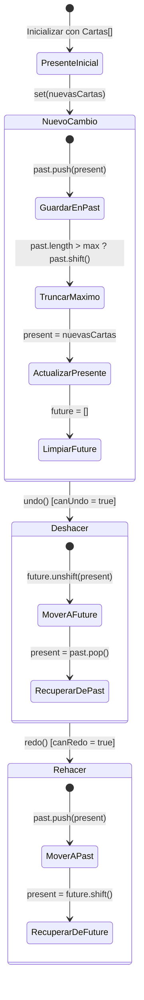

# SRS-088: Historial de Deshacer y Rehacer (Undo / Redo) en el Lienzo de Cartas

**Estado**: Completado  
**Fecha**: 2026-10-25  
**Versión**: `v2.261025.2`  
**Autor**: Card Deck Crafter Team & AI Pair Programmer  
**Alcance**: Frontend (`client`)  

---

## 1. Introducción y Objetivos

### 1.1. Propósito
Proporcionar a los usuarios de Card Deck Crafter v2 un sistema ágil, intuitivo y confiable de **Deshacer (Undo)** y **Rehacer (Redo)** directamente accesible desde la barra superior de herramientas del lienzo (`workspace-toolbar`) y mediante los atajos de teclado estándar del sistema operativo (`Ctrl+Z`, `Ctrl+Y` / `Ctrl+Shift+Z`). 

Permite revertir y re-aplicar cambios realizados en las cartas del documento activo (modificación de campos y propiedades, duplicación, eliminación, reordenación y arrastre/redimensionado interactivo de capas en el lienzo) sin riesgo de pérdida accidental de datos.

### 1.2. Objetivos de Diseño
1. **Rendimiento Instantáneo ($O(1)$)**: Almacenamiento del historial en la memoria volátil de JavaScript (RAM) mediante pilas duales (`past` y `future`), evitando cuellos de botella de I/O o cuotas de almacenamiento (como el límite estricto de 5 MB de `localStorage`/`sessionStorage`).
2. **Consumo de Memoria Acotado**: Límite configurable de pasos en la pila (por defecto: **40 pasos**) descartando automáticamente los estados más antiguos mediante una política FIFO cuando se supere el tope.
3. **Modularidad y Reusabilidad**: Encapsulación completa de la lógica de historial en un hook genérico `useHistory<T>`, aislado y con pruebas unitarias exhaustivas.
4. **Granularidad Inteligente (Anti-Saturación)**:
   - Los movimientos continuos en el lienzo (`drag` / `resize`) no deben registrar estados por cada píxel recorrido; se consolida un único paso al soltar el ratón (`mouseup`).
   - La edición de texto en tiempo real se consolida al finalizar la edición o tras pausas lógicas, evitando un estado por cada carácter pulsado.
5. **Ergonomía de Teclado**: Soporte para `Ctrl+Z`, `Cmd+Z`, `Ctrl+Y`, `Cmd+Y` y `Ctrl+Shift+Z` / `Cmd+Shift+Z`, respetando el comportamiento nativo del navegador cuando el foco esté dentro de un campo `<input>` o `<textarea>`.

---

## 2. Requisitos Funcionales y Casos de Uso

### RF-1: Hook Genérico de Historial (`useHistory<T>`)
- Debe mantener tres estructuras de datos: `past: T[]`, `present: T`, `future: T[]`.
- Métodos públicos:
  - `set(newVal, options?: { skipHistory?: boolean })`: Establece un nuevo valor presente. Si `skipHistory` no está activo, apila el estado presente anterior en `past`, trunca la pila si excede `maxHistory` y vacía la pila `future`.
  - `undo()`: Si `past.length > 0`, mueve el `present` a la cabeza de `future`, extrae el último elemento de `past` y lo convierte en el nuevo `present`.
  - `redo()`: Si `future.length > 0`, mueve el `present` a la cola de `past`, extrae el primer elemento de `future` y lo convierte en el nuevo `present`.
  - `clear()`: Limpia las pilas `past` y `future`, manteniendo el valor `present` actual.
  - Indicadores booleanos: `canUndo` (`past.length > 0`) y `canRedo` (`future.length > 0`).

### RF-2: Botones de Deshacer y Rehacer en la Barra del Lienzo (`workspace-toolbar`)
- Se ubicarán en la barra superior de herramientas del lienzo (`workspace-toolbar`), antes de las herramientas de selección o junto a ellas con un separador visual limpio.
- **Botón Deshacer**:
  - Icono: ↺ (o SVG representativo de flecha curvada hacia la izquierda).
  - Texto / Tooltip: `Deshacer (Ctrl+Z)`.
  - Atributo `disabled` activo con estilo visual atenuado (`opacity: 0.4`, `cursor: not-allowed`) cuando `canUndo === false`.
- **Botón Rehacer**:
  - Icono: ↻ (o SVG representativo de flecha curvada hacia la derecha).
  - Texto / Tooltip: `Rehacer (Ctrl+Y)`.
  - Atributo `disabled` activo con estilo visual atenuado cuando `canRedo === false`.
- **Persistencia en Lienzo Vacío**: Los botones deben permanecer visibles incluso si `cartas.length === 0`, de modo que si un usuario elimina por error todas las cartas de una página, pueda presionar `Deshacer` y recuperarlas de inmediato.

### RF-3: Integración con las Operaciones de Edición de Cartas
El historial debe capturar automáticamente los cambios de estado en las siguientes operaciones:
1. **Edición de campos en el Inspector / Modal de Carta**: Actualización de textos, valores dinámicos, imágenes, colores o visibilidad.
2. **Duplicación de cartas**: Selección individual o múltiple duplicada vía botón de barra (`📋`) o comando.
3. **Eliminación de cartas**: Eliminación individual o múltiple vía botón de papelera (`🗑️`) o tecla Supr.
4. **Reordenación de cartas**: Movimiento arriba (`⬆️`) o abajo (`⬇️`) en la secuencia de impresión.
5. **Añadir nueva carta**: Inserción de carta desde plantilla o manual.

### RF-4: Manejo Especial de Arrastre y Redimensionado en el Lienzo
- En [`handleLayerCanvasMouseDown`](file:///c:/Users/victo/proyectos/cdc2/client/src/App.tsx#L325), al iniciar el arrastre o redimensión, se almacena una instantánea del estado inicial de las cartas antes del movimiento.
- Durante `mousemove`, las posiciones temporales actualizan el lienzo en tiempo real para mantener 60 FPS sin saturar la pila de historial.
- Al dispararse `mouseup`, si las coordenadas o dimensiones cambiaron respecto al inicio, se confirma la transacción como un único paso en el historial. Si el usuario cancela o no movió la capa, no se genera ningún paso espurio.

### RF-5: Atajos de Teclado Globales
- Escuchar eventos `keydown` a nivel `window`:
  - `Ctrl + Z` / `Meta + Z` (sin Shift) ➔ Ejecuta `undo()`.
  - `Ctrl + Y` / `Meta + Y` o `Ctrl + Shift + Z` / `Meta + Shift + Z` ➔ Ejecuta `redo()`.
- **Exclusión de campos de texto**: Si `document.activeElement` es una etiqueta `INPUT`, `TEXTAREA` o un elemento con `isContentEditable === true`, el evento de teclado no debe ser interceptado ni cancelado (`e.preventDefault()` omitido), preservando el historial de texto nativo del navegador.

---

## 3. Arquitectura y Diseño de Datos

### 3.1. Tipado e Interfaces (TypeScript)

```typescript
// client/src/hooks/useHistory.ts

export interface HistoryOptions {
  maxHistory?: number; // Por defecto: 40
}

export interface HistoryState<T> {
  past: T[];
  present: T;
  future: T[];
}

export interface UseHistoryReturn<T> {
  state: T;
  set: (newVal: T | ((prev: T) => T), options?: { skipHistory?: boolean }) => void;
  undo: () => void;
  redo: () => void;
  clear: () => void;
  canUndo: boolean;
  canRedo: boolean;
  historyLength: {
    past: number;
    future: number;
  };
}
```

### 3.2. Diagrama de Transición de Estados



---

## 4. Interfaces de Componentes / API

### 4.1. Ubicación en la Barra Superior del Lienzo (`workspace-toolbar`)

```tsx
<div className="workspace-toolbar">
  {/* Grupo de Deshacer / Rehacer */}
  <div className="undo-redo-toolbar-group" style={{ display: "flex", gap: "4px", alignItems: "center" }}>
    <button
      type="button"
      className="toolbar-btn"
      onClick={handleUndo}
      disabled={!canUndo}
      title="Deshacer (Ctrl+Z)"
      aria-label="Deshacer última acción"
    >
      ↺
    </button>
    <button
      type="button"
      className="toolbar-btn"
      onClick={handleRedo}
      disabled={!canRedo}
      title="Rehacer (Ctrl+Y)"
      aria-label="Rehacer última acción"
    >
      ↻
    </button>
  </div>

  <span className="toolbar-separator" />

  {/* Resto de acciones de selección existentes (Select All, Invert, Delete, etc.) */}
  ...
</div>
```

---

## 5. Estrategia de Verificación (Pruebas)

### 5.1. Pruebas Unitarias Automatizadas (`vitest`)
1. **`client/src/hooks/useHistory.test.ts`**:
   - Inicialización correcta con `canUndo = false` y `canRedo = false`.
   - Modificación mediante `set`: el estado `past` se incrementa y `canUndo` pasa a `true`.
   - Ejecución de `undo`: restaura el estado previo y habilita `canRedo`.
   - Ejecución de `redo`: vuelve al estado modificado y decrementa `future`.
   - Verificación de la poda de pila: asegurar que al superar `maxHistory` (ej. 40 pasos), los estados antiguos son descartados sin fugas de memoria.
   - Bifurcación de historial: al realizar un nuevo cambio tras un `undo`, la pila `future` debe quedar vacía.
2. **`client/src/SRS088UndoRedoLienzo.test.tsx`**:
   - Renderizado de los botones ↺ y ↻ en la barra de herramientas del lienzo.
   - Desactivación de botones cuando no hay historial.
   - Activación del botón de deshacer tras duplicar o eliminar una carta.
   - Verificación del atajo de teclado `Ctrl+Z` y `Ctrl+Y` mediante disparadores de eventos `keydown`.
   - Verificación de no intercepción de `Ctrl+Z` dentro de un `<input>`.

### 5.2. Pruebas Manuales / Checklist de Aceptación
- [ ] Abrir o crear un proyecto con cartas en el lienzo.
- [ ] Verificar que los botones ↺ y ↻ se muestran atenuados (deshabilitados) de entrada.
- [ ] Duplicar una carta: verificar que el botón ↺ se activa.
- [ ] Pulsar el botón ↺: la carta duplicada desaparece y el botón ↻ se activa.
- [ ] Pulsar el botón ↻: la carta duplicada reaparece exactamente en su posición.
- [ ] Probar los atajos de teclado `Ctrl+Z` y `Ctrl+Y` en Windows / Linux y `Cmd+Z` / `Cmd+Shift+Z` en Mac.
- [ ] Arrastrar una capa dentro de una carta en el lienzo: verificar que tras soltar el ratón, un solo `Ctrl+Z` devuelve la capa a su posición original.
- [ ] Editar un campo de texto en un modal o inspector: verificar que mientras se escribe dentro del input, `Ctrl+Z` deshace el texto local del campo sin disparar el deshacer del lienzo global.
