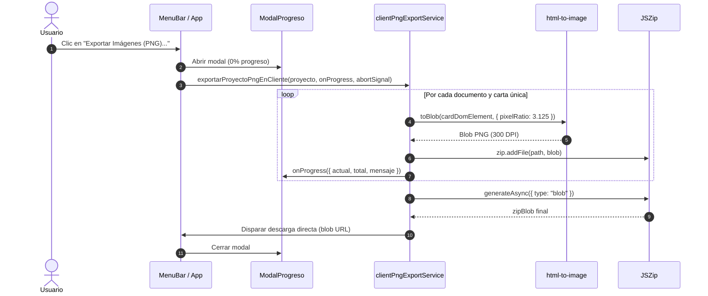

# SRS-089: Exportación Masiva de Imágenes PNG en Cliente a 300 DPI y Renderizado Backend Acotado para Agentes

**Estado**: Completado  
**Fecha**: 2026-10-26  
**Versión**: `v2.261026.1`  
**Autor**: Card Deck Crafter Team & AI Pair Programmer  
**Alcance**: Frontend (`client`) y Backend (`server`)  

---

## 1. Introducción y Objetivos

### 1.1. Propósito
Resolver de forma definitiva las demoras excesivas, bloqueos y errores de tiempo de espera (`504 Gateway Time-out`) al exportar barajas de cartas a imágenes PNG en alta resolución (300 DPI). 

Para lograrlo, la arquitectura separa dos responsabilidades claras:
1. **Frontend (Herramienta Web)**: Delegar el 100% del procesamiento de exportación masiva al navegador del usuario utilizando `html-to-image` y `JSZip`. Esto aprovecha la GPU local del cliente, reduce los tiempos de minutos a pocos segundos, elimina la carga en el servidor VPS/Raspberry Pi y proporciona una barra de progreso visual en tiempo real.
2. **Backend (Entornos Agénticos y Headless)**: Mantener el endpoint `/api/exportar/png` en Node.js/Puppeteer optimizado y acotado para llamadas automatizadas, agentes de IA (MCP) o herramientas CLI que requieran renderizar cartas individuales o lotes pequeños de prueba, protegiendo el servidor contra agotamiento de memoria RAM (OOM).

### 1.2. Objetivos de Diseño
- **Cero Carga en el Servidor Web**: La exportación masiva desde la aplicación web no debe consumir CPU ni memoria RAM en el servidor de producción ni en la Raspberry Pi.
- **Calidad Profesional de Impresión (300 DPI)**: Las imágenes se rasterizan con factor de densidad `pixelRatio = 3.125` ($\frac{300 \text{ DPI}}{96 \text{ DPI}}$), ajustadas al tamaño neto de la carta en milímetros sin márgenes de sangrado.
- **Experiencia de Usuario Fluida (Feedback Visual)**: Modal con barra de progreso que informe el avance en tiempo real (*"Procesando carta 15 de 48 (31%)..."*) y permita cancelar el proceso si el usuario lo desea.
- **Compatibilidad con Estructura ZIP (SRS-054)**: El archivo descargado mantiene exactamente la misma organización: subcarpetas por documento, nomenclatura contigua `cartaXXX-D.png` / `cartaXXX-T.png` y archivo `info.txt`.
- **Protección y Soporte Agéntico en Backend**: El backend soportará la exportación de una carta concreta (ej. `?cardIndex=1` o `?cardId=...`) devolviendo directamente la imagen `image/png` y limitará las peticiones masivas sin filtro a un máximo seguro (ej. 10 cartas) para evitar caídas del servicio por falta de memoria.

---

## 2. Requisitos Funcionales y Casos de Uso

### RF-1: Motor de Renderizado en Cliente (`clientPngExportService.ts`)
- Utilizar `html-to-image` para capturar el nodo DOM de cada carta fuera de pantalla (*offscreen*) a 300 DPI exactos (`pixelRatio: 3.125`).
- **Deduplicación de caras**:
  - Si una carta tiene `cantidad > 1`, se captura la imagen una única vez y el blob se reutiliza para todas sus copias físicas en el ZIP.
  - Si el documento tiene trasera común (`modoTraseras === 'comun'`), el reverso común se captura una única vez y se reutiliza para todas las cartas.
- **Empaquetado en ZIP con `JSZip`**:
  - Generar la estructura de carpetas: `[Nombre_Documento]/cartaXXX-D.png`, `cartaXXX-T.png` e `info.txt`.
  - Crear el archivo final `[nombre_proyecto]_imagenes.zip` y disparar la descarga automática mediante un enlace Blob local.

### RF-2: Modal de Progreso en Tiempo Real en la Interfaz
- Al pulsar `Archivo > Exportar Imágenes (PNG)...`, se abre un modal visual con:
  - Título: *"Exportando Imágenes PNG (300 DPI)"*.
  - Indicador de estado: *"Documento 1 de 2: Página 1"*.
  - Mensaje descriptivo: *"Renderizando carta 18 de 50 (36%)..."*.
  - Barra de progreso porcentual fluida (0% a 100%).
  - Botón **Cancelar** que aborta la operación de forma inmediata sin generar la descarga ni consumir recursos adicionales.

### RF-3: Adaptación del Endpoint Backend (`/api/exportar/png`) para Uso Agéntico
- El endpoint aceptará parámetros opcionales de filtrado:
  - `cardIndex`: Índice de la carta a exportar (1-based).
  - `cardId`: Identificador único de la carta.
  - `face`: `"front"` (delantera), `"back"` (trasera) o `"both"` (ambas, por defecto).
- **Respuesta para carta individual**:
  - Si se solicita una sola cara (`face="front"` o `"back"`), responde directamente con `Content-Type: image/png` y el binario de la imagen.
  - Si se solicita `"both"`, devuelve un ZIP ligero con ambas caras.
- **Protección contra caídas por memoria (OOM)**:
  - Si la petición solicita procesar la baraja completa sin especificar carta individual, el backend aplicará un límite de seguridad máximo de **10 cartas** (o devolverá un error HTTP 400 sugiriendo exportar desde el cliente web o especificar un índice de carta).

---

## 3. Arquitectura y Diseño de Datos

### 3.1. Flujo de Exportación en Cliente



### 3.2. Interfaces TypeScript

```typescript
// client/src/services/clientPngExportService.ts

export interface ExportProgressInfo {
  documentoActual: string;
  indiceDoc: number;
  totalDocs: number;
  cartaActual: number;
  totalCartas: number;
  porcentaje: number;
  mensaje: string;
}

export interface ClientPngExportOptions {
  proyecto: ProyectoCDC2;
  onProgress?: (progress: ExportProgressInfo) => void;
  signal?: AbortSignal;
}
```

---

## 4. Interfaces de Componentes / API

### 4.1. Componente Modal de Progreso (`client/src/components/ExportProgressModal.tsx`)
- Renderiza una barra con estilo visual consistente con CDC2 (fondo oscuro, acento azul cian/índigo, tipografía monospace para porcentajes).
- Permite cancelación instantánea utilizando un `AbortController`.

### 4.2. API Backend Acotada (`server/src/index.ts`)
```http
POST /api/exportar/png?cardIndex=1&face=front
Content-Type: multipart/form-data (archivoProyecto: .cdc2)

Response:
HTTP/1.1 200 OK
Content-Type: image/png
Content-Disposition: inline; filename="carta001-D.png"
[Binary PNG Data]
```

---

## 5. Estrategia de Verificación (Pruebas)

### 5.1. Pruebas Unitarias Automatizadas
1. **`client/src/services/clientPngExportService.test.ts`**:
   - Generación de estructura de carpetas correcta para múltiples documentos.
   - Deduplicación de capturas ante cartas con `cantidad > 1`.
   - Reutilización de imagen trasera común (`modoTraseras === 'comun'`).
   - Generación correcta del archivo `info.txt`.
   - Soporte de cancelación mediante `AbortSignal`.
2. **`server/src/exportSingleCard.test.ts`**:
   - Petición con `cardIndex=1` y `face=front` retorna código 200 y `image/png`.
   - Petición sin filtro con más de 10 cartas retorna advertencia o límite acotado seguro.

### 5.2. Pruebas Manuales / Checklist de Aceptación
- [ ] Abrir un proyecto con 30 o más cartas en el cliente web.
- [ ] Seleccionar `Archivo > Exportar Imágenes (PNG)...`.
- [ ] Verificar que aparece el modal con la barra de progreso avanzando suavemente sin bloquear la pestaña.
- [ ] Comprobar que el archivo ZIP se descarga en pocos segundos sin enviar tráfico pesado al servidor.
- [ ] Descomprimir el ZIP y comprobar la resolución exacta (300 DPI), la paridad `D/T` y el archivo `info.txt`.
- [ ] Iniciar una exportación y pulsar "Cancelar": verificar que se detiene de inmediato.
